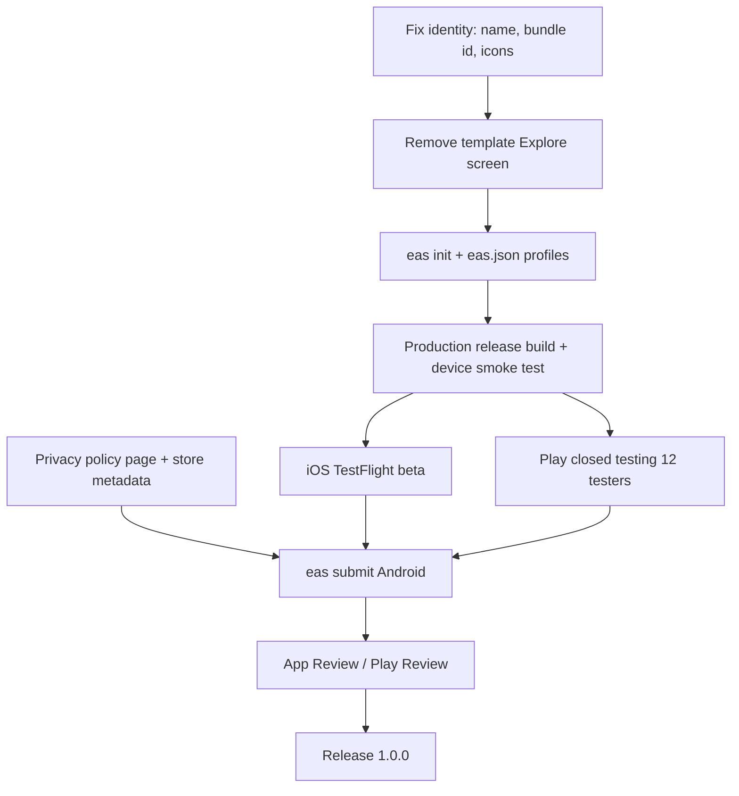

# FeedMyBaby — App Store & Google Play Publish Readiness Report

> **Historical report:** The product is now **BubbiFeed** (brand-only rename,
> 2026-09-07). Names, identifiers, dates and findings below describe their original
> review/release context, not today's configuration. They have not been rewritten.
> See the [current project overview](../README.md) and [rebrand audit](bubbifeed-rebrand.md).

Reviewed: 2026-08-15 · Expo SDK 56 (`expo ~56.0.3`, React Native `0.85.3`) · Workspace: `feedmybaby`

**Overall verdict: 🔴 NOT READY for submission.** The core app functionality (feeding logging, history, insights, settings) is implemented and fully offline, which is a privacy advantage. However, the project is still in "fresh Expo template" state regarding distribution: placeholder identifiers, template branding, leftover template screens, and zero build/release pipeline. Estimated **14 blocking** and **8 non-blocking** gaps below.

---

## 1. Current state summary

| Aspect | Current state | Store impact |
|---|---|---|
| App name / slug | `feedmybaby` (lowercase, placeholder-like) | Needs marketing name |
| iOS bundle ID | `com.anonymous.feedmybaby` in [`app.json`](app.json:12) | ❌ Apple will reject |
| Android package | `com.anonymous.feedmybaby` in [`app.json`](app.json:22) | ⚠️ Technically allowed, must change before first release (immutable afterwards) |
| EAS config | No `eas.json`, no `expo.extra.eas.projectId` | ❌ No build/submit pipeline |
| iOS icon | [`assets/expo.icon`](assets/expo.icon/icon.json) = Expo template symbol | ❌ Wrong branding; Apple expects custom icon |
| Android adaptive icon | Template assets (`android-icon-*.png`) | ❌ Wrong branding |
| Explore tab | [`src/app/explore.tsx`](src/app/explore.tsx:14) is Expo starter content | ❌ Looks unfinished; risk of Apple 4.2 rejection (minimum functionality/placeholder content) |
| Privacy policy | None exists (no website in repo) | ❌ Required by both stores as a URL |
| Crash reporting / analytics | None | ⚠️ Recommended |
| OTA updates | `expo-updates` not configured | ⚠️ Optional |
| Version | `1.0.0`, no `versionCode`/`buildNumber` strategy | ⚠️ Needs per-build incrementing |

---

## 2. Blocking gaps

### A. Identity & configuration (both stores)

1. **Replace `com.anonymous.feedmybaby`** with a real bundle ID / package name tied to your developer account (e.g. `com.<yourdomain>.feedmybaby`). Apple rejects `com.anonymous.*`; Google Play permits it but it cannot be changed after first release.
2. **Finalize app display name.** Both stores have display-name uniqueness and length limits (iOS ≤ 30 chars). Decide the marketed name and set it in [`app.json`](app.json:3) (`expo.name`); consider distinct `ios.buildNumber` handling.
3. **Remove or replace the template Explore screen** [`src/app/explore.tsx`](src/app/explore.tsx) and its tab trigger in [`src/components/app-tabs.tsx`](src/components/app-tabs.tsx) (or repurpose it as an About/Help screen). Store reviewers treat leftover template content as unfinished/spammy.
4. **Replace all Expo template branding**: iOS icon [`assets/expo.icon`](assets/expo.icon/icon.json), [`assets/images/icon.png`](assets/images/icon.png), Android adaptive icon assets, splash [`assets/images/splash-icon.png`](assets/images/splash-icon.png) and splash color in [`app.json`](app.json:31).

### B. Build & release pipeline

5. **Set up EAS** (recommended) — `npx eas init` creates the project + `eas.json` with `development`, `preview`, `production` profiles; EAS manages iOS certificates/provisioning and the Android upload keystore. Alternative: local Xcode/Android Studio builds with your own signing material.
6. **Versioning strategy** — keep `expo.version` as marketing version; set `ios.buildNumber` and `android.versionCode` per build (EAS can auto-increment with `"autoIncrement": true` in `eas.json`).
7. **Release build verification** — build and smoke-test a real `production` release build on a physical iOS device and Android device (release-mode behavior differs: Hermes, no dev menu, image perf).
8. **iOS: TestFlight beta round** before App Review. **Android: internal/closed testing track** first. Note: Google Play requires new *personal* developer accounts (created after Nov 2023) to run a closed test of ≥12 testers for 14 continuous days before production access.

### C. Store metadata & legal (not in repo — must be created)

9. **Privacy policy URL** — required by both stores even though data never leaves the device. The app stores baby feeding/health data locally via [`StorageService`](src/utils/storage.ts:90); both questionnaires will ask about health data. Host a policy page stating: no data collection, all data stored on-device, deletion via profile delete / app uninstall.
10. **App Store metadata**: screenshots (6.9" iPhone required; 6.5" and iPad if supported), app description, keywords, category (Health & Fitness or Lifestyle), subtitle, support URL, copyright line, App Review contact info.
11. **App Privacy Details (Apple)**: answer "Data Not Collected" (everything stays on device; no network calls, no analytics SDKs in [`package.json`](package.json:5)). Verify no third-party SDK appears in the privacy nutrition labels.
12. **Google Play Console assets**: 512×512 icon, 1024×500 feature graphic, ≥2 phone screenshots, short + full description, app category, contact email.
13. **Google Data Safety form**: no data collected/shared; "data encrypted in transit" N/A (no network); users can delete data (profile deletion in [`src/app/settings.tsx`](src/app/settings.tsx:126)).
14. **Content rating + target audience**: complete IARC questionnaire on Play and age rating on App Store. ⚠️ Declare target audience as **parents/adults (17+/18+)** — declaring children as the audience triggers stricter Families/teacher-approved policies. The app is *about* babies, *for* parents; answer accordingly.

---

## 3. Non-blocking gaps (recommended)

1. **Crash/error reporting** — add `sentry-expo`/`@sentry/react-native` to catch production issues; both stores ask about crash rates indirectly via review quality.
2. **OTA updates** — configure `expo-updates` + EAS Update so you can patch JS bugs without full store review (note: native changes still require store builds).
3. **Data durability warning** — all data lives in AsyncStorage ([`src/utils/storage.ts`](src/utils/storage.ts)); uninstall = total data loss. Consider an export/import (JSON share) feature; not a store requirement.
4. **README** — still the `create-expo-app` template ([`README.md`](README.md)); update for your own docs.
5. **Experimental API risk** — [`NativeTabs` from `expo-router/unstable-native-tabs`](src/components/app-tabs.tsx:1), `@expo/ui`, `expo-glass-effect`, and `reactCompiler` experiment ([`app.json`](app.json:41)) are newer/experimental. Test thoroughly on both platforms in release mode.
6. **Tablet support** — `ios.supportsTablet` is unset (defaults to iPhone-only). That's acceptable; verify the app does not claim iPad support, or add proper iPad layouts.
7. **Localization** — app is English-only; fine for launch, add `expo-localization` later if needed.
8. **CI** — add a GitHub Action with `npx expo-doctor` + TypeScript check + EAS build triggers to keep releases reproducible.

---

## 4. Positive findings ✅

- Fully offline, no tracking/analytics SDKs → simplest possible privacy answers on both stores.
- [`package.json`](package.json) uses pinned/tilted Expo SDK 56 versions consistent with `bundledNativeModules` — no version drift detected.
- Portrait orientation, splash screen, adaptive icon structure, and tab icons already configured.
- Data deletion paths exist (delete profile/log) — helps Data Safety/App Privacy answers.
- `.gitignore` correctly excludes keystores/keys (`*.jks`, `*.p8`, `*.p12`, `*.key`, `*.mobileprovision`) — good hygiene for when signing keys are added.

---

## 5. Action plan (ordered)

1. Decide final app name + bundle ID/package (requires your domain/account) — update [`app.json`](app.json)
2. Remove template Explore tab or convert to About/Help; delete template copy from [`src/app/explore.tsx`](src/app/explore.tsx), [`src/components/app-tabs.tsx`](src/components/app-tabs.tsx)
3. Design/replace app icon (iOS + Android), splash, and any Expo-badge assets
4. `npx eas init` → create `eas.json` with preview + production profiles, auto-increment builds
5. Create & host privacy policy page (can be a static page)
6. Release-build smoke test on real iOS + Android devices; fix anything found
7. TestFlight beta (iOS) + Play closed testing track (≥12 testers / 14 days if new personal account)
8. Prepare store metadata: screenshots, descriptions, keywords, categories, ratings
9. Submit via `eas submit --platform ios` / `--platform android` after beta sign-off
10. (Optional) Add Sentry + EAS Update + CI

## 6. Open questions for the owner

1. Apple Developer Program + Google Play Console accounts: do you have them? (New Play personal accounts have the 12-tester/14-day testing requirement.)
2. Build pipeline: EAS cloud builds (recommended) or local Xcode/Android Studio?
3. ~~Final marketed app name and bundle-ID namespace~~ → decided, see §7.
4. Keep iPhone-only, or add iPad/tablet support?

---

## 7. Decisions log

| Date | Decision |
|---|---|
| 2026-08-16 | App marketing name: **FeedMyBaby**. Bundle identifier / Android package: **com.nfusia.feedmybaby** (owner domain: nfusia.com). Slug stays `feedmybaby`. |

## 8. Step-by-step execution checklist

### Step 1 — App identity ✅ (done 2026-08-16)

Code-mode changes to [`app.json`](app.json):

1. `expo.name`: `"feedmybaby"` → `"FeedMyBaby"` (line 3).
2. `expo.slug`: keep `"feedmybaby"` (URL-safe, unchanged).
3. `ios.bundleIdentifier`: `"com.anonymous.feedmybaby"` → `"com.nfusia.feedmybaby"` (line 12).
4. `android.package`: `"com.anonymous.feedmybaby"` → `"com.nfusia.feedmybaby"` (line 22).

Post-change verification (owner runs locally):

5. `npx expo prebuild --clean` to regenerate `/ios` and `/android` with the new identifiers (native dirs are gitignored, so regeneration is safe).
6. `npx expo run:ios` / `npx expo run:android` smoke test that the app still launches.

Notes:

- Safe to change identifiers now because no store build has ever been uploaded.
- Existing local `/ios`/`/android` folders (if any) are disposable generated artifacts.

### Step 2 — Remove template Explore screen ✅ (done 2026-08-16)

1. Deleted [`src/app/explore.tsx`](src/app/explore.tsx) (was already an orphan route — neither tab component referenced it).
2. Deleted orphaned template assets: `explore.png` tab icons (@1x/@2x/@3x), `expo-badge.png`, `expo-badge-white.png`, `react-logo*.png`, `tutorial-web.png`.
3. Deleted orphaned [`src/components/web-badge.tsx`](src/components/web-badge.tsx) (only used by Explore screen).
4. `npx tsc --noEmit` passes.

Remaining template branding (handled in Step 3): iOS icon `assets/expo.icon`, `assets/images/icon.png`, Android adaptive icon assets, `splash-icon.png`, `logo-glow.png` (splash animation), favicon.

### Step 3 — Branding ✅ (done 2026-08-16)

1. New brand mark: white baby-bottle with heart cutout on coral→rose gradient (`#FFB199`→`#F7A8B8`), matching the app's nursery palette in [`src/constants/theme.ts`](src/constants/theme.ts).
2. SVG sources added under `assets/brand/` (icon, android-background/foreground/monochrome, splash, favicon) + `scripts/generate-icons.sh` (headless Chrome renderer) to regenerate all PNGs.
3. Regenerated: `icon.png` (1024), `android-icon-*.png` (432), `splash-icon.png` (288), `favicon.png` (48).
4. [`app.json`](app.json): removed `ios.icon` expo.icon template override (falls back to `expo.icon`), splash `backgroundColor` `#208AEF` → `#FFF9F6` (app cream).
5. Removed orphaned `AnimatedIcon` (Expo logo + glow) from [`src/components/animated-icon.tsx`](src/components/animated-icon.tsx) / `.web.tsx`; deleted `expo-logo.png`, `logo-glow.png`, `animated-icon.module.css`, `assets/expo.icon/`.
6. `npx tsc --noEmit` passes. Splash overlay now fades the app cream color.

### Step 4 — EAS setup (in progress)

1. ✅ `eas-cli` added as devDependency.
2. ✅ `eas.json` created: `development` / `preview` (internal, iOS simulator) / `production` (autoIncrement) profiles + `submit.production` stubs (TODO placeholders for Apple IDs and Play service account).
3. ⏳ BLOCKED on owner: create Expo account (free) at expo.dev/signup, then `npx eas login` and `npx eas init` to link the project (writes `expo.extra.eas.projectId` into app.json).

### Step 5 — Official website ✅ (done 2026-08-23, deploy pending)

Static site in `site/` for Cloudflare Pages (build output dir = `site`, no build command).
**Hosted at subpath**: app site lives at `nfusia.com/feedmybaby/`; apex `nfusia.com` shows a minimal Nfusia studio landing linking to it.

Structure:
- `site/index.html` — apex studio landing (links to `feedmybaby/`)
- `site/feedmybaby/index.html` — branded app landing page with feature grid + "Coming soon" store badges
- `site/feedmybaby/privacy.html` — full privacy policy (no data collected; on-device storage; deletion paths; children's privacy; contact) — satisfies both stores' required privacy-policy URL
- `site/feedmybaby/support.html` — support/FAQ page with contact email — satisfies App Store support-URL requirement
- `site/feedmybaby/style.css` brand-matched styles; `site/_headers` security headers (site-wide)
- Assets: `site/feedmybaby/icon-512.png`, `site/feedmybaby/favicon.png` (regenerate via `scripts/generate-icons.sh`)

Full deploy steps: [`site/DEPLOY.md`](site/DEPLOY.md). All app links are relative so the site works on both `feedmybaby.pages.dev` and `nfusia.com` unchanged.

Store URLs once live:
- Privacy policy: `https://nfusia.com/feedmybaby/privacy.html`
- Support: `https://nfusia.com/feedmybaby/support.html`
- Website: `https://nfusia.com`

Owner TODOs before store submission:
- Deploy `site/` to Cloudflare Pages and attach `nfusia.com` custom domain.
- Create the `support@nfusia.com` mailbox (Cloudflare Email Routing).
- Replace store-badge placeholders with real links once listings exist.
